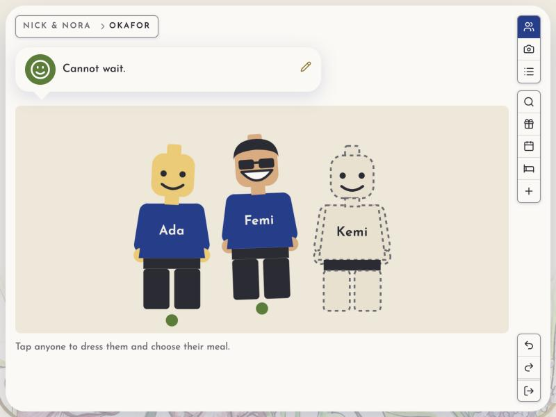

# eta

**Live apps for a few people at once, told as stories and checked by them.**



People use more than one screen. Ann asks for a day off on her phone, and her manager sees it
waiting on the calendar a moment later, with no refresh. Ben changes his note on his laptop, and
his phone shows it. eta makes that the normal way a page works: you write no sync code.

## A story is the spec and the test

You start by saying what people do, in sentences a customer could call true or false:

```ts
story("Ada says hello; Bob, in the room, sees it; Cy, in the kitchen, does not", ...)
story("Ann asks for her draft, and Mo and Bo see it waiting on the calendar, and she sees it waiting in her drawer", ...)
story("Ann cannot approve her own day off", ...)
```

`bun run stories` runs each one against the real app, over real sockets. It checks the change
lands, that the right people's pages change, that nobody else is sent anything, and that undo and
redo put every page back. Then it does each again by hand, in a browser the size of a phone. You
build the least that makes the next story pass, and nothing a story doesn't need.

## Start a project

```bash
bun create dzql my-app
cd my-app
bun install
bun run model
```

You tell Claude the stories. It writes them down on the model's page (http://localhost:3001)
while you watch, with the documents they need and who holds each. Then it builds the app from the
model (`bun dev`, http://localhost:3000), story by story.

The project's app is in `src/`; dzql and delta come from `node_modules`, and you never edit
them there. A later eta is a version bump of `dzql` in `package.json`, then your gate.

## Try the examples

You need [Bun](https://bun.sh). Then `bun install` at the root and `bun run dev` in `packages/dzql`, and open
http://localhost:3000. That is chat: give a name, name a room, say something. Open a private window
as someone else and you each see the other speak. Undo, bottom right, takes back your own last
write.

- `bun run dev:wedding` (port 3001): a site for one wedding, the picture above. Codes: `NICK` for
  the couple, `OKAFOR` and `BEN` for two households.
- `bun run dev:leave` (port 3004): a team's leave on one calendar. Drag across days to ask. Sign in
  as `ann@leave.example`, `bo@leave.example` or `mo@leave.example` (the manager); each password is
  the name and `-password`.
- `bun run dev:ticker` (port 3002): a price board and a Swiss railway clock.
- `bun run dev:modeling` (port 3005): the model's page, where an app is told before it is built.

## Why eta

- **No sync code.** The server draws each person's page and sends only the parts that changed, to
  every screen that shows them.
- **Undo for each person.** Undo walks back your own writes while others keep writing, and says so
  when someone has changed it since.
- **Stories are the tests.** Every example's, run over real sockets and again by hand.
- **A small client.** <!-- measured:client -->7.4 KB<!-- /measured --> gzipped, and no framework
  to learn. The page is plain HTML, drawn on the server.
- **One process.** Bun and SQLite, nothing else to run.

It suits small teams where seeing what happened and being able to undo it matter more than scale:
a wedding, a booking board, a classroom, an ops console. It is not built for a large consumer
product.

## What it is made of

- **[@blueshed/delta](https://www.npmjs.com/package/@blueshed/delta)** keeps the documents, their
  history and their one stream of changes.
- **[@blueshed/railroad](https://www.npmjs.com/package/@blueshed/railroad)** can draw an applet, a small
  part of a page that keeps its own state in the browser, like a drag or a chart: an island (<!-- measured:railroad -->2.9 KB
  gzipped for `signal` and `mount`, 3.7 KB with `list`<!-- /measured -->, only on a page that has one).

## What a write costs

After a change, each page that shows it gets only the parts that changed, compressed. `bun run
costs` measures every number on this page from a fresh run, and `bun run test:eta` fails when they drift.

<!-- measured:writes -->
- **Chat**, one message in a room of 100 messages and 5 members: 423 B, compressed from 881 B, to
  each other member (a 182 B patch and 241 B of HTML).
- **The ticker**, one price tick with 5 viewers watching its symbol: 178 B, compressed from 203 B,
  to each other viewer (patches of 90 B and 88 B, and no HTML). The same tick as a bare JSON feed
  would be 41 B.
- **The wedding**, one guest's top changed to green: 823 B, compressed from 2.1 KB, to the same
  household's second tab, on its photo (patches of 147 B and 227 B, and 449 B of HTML); 751 B,
  compressed from 5.3 KB, to the couple, on their photo of families (a 136 B patch and 615 B of
  HTML); 227 B, compressed from 315 B, to another household, on its photo (one patch and no HTML);
  and 227 B, compressed from 315 B, to another household, reading everyone (one patch and no HTML).
<!-- /measured -->

## Commands

```
bun run dev          # chat, reloading as you edit (dev:wedding, dev:leave, dev:ticker, dev:modeling)
bun run stories      # one example's stories; stories:all runs every example's
bun run test:eta     # the tests, at 100% coverage
bun check            # the type check (Bun 1.4.3 or later)
bun run cli <verb>   # a terminal client: watch every change, undo, write
bun run model:check  # read an app that exists as a model: who holds what, who is told
bun run costs        # measure every number on this page
```

`ETA_EXAMPLE=<name>` picks the example for `dev`, `start`, `stories` and `cli`; `.env.example`
explains every setting.

## Learn more

- [docs/dzql/rendering/first-app.md](first-app.md): a first app, step by step.
- [docs/dzql/modelling/stories.md](../modelling/stories.md): what eta is for, and how stories drive it.
- [docs/dzql/rendering/bento/README.md](bento/README.md): a guide to pages where people know where they are
  and what they can do.
- [docs/dzql/rendering/least-resistance.md](least-resistance.md): why eta suits an AI that builds apps.
- `packages/dzql/CHANGELOG.md`: what changed, and how to move an app across a change.
