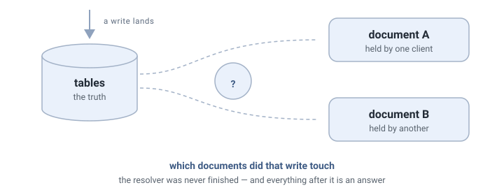
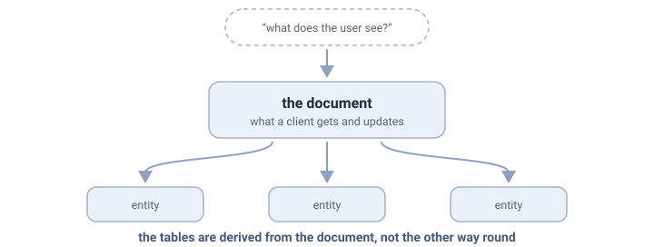
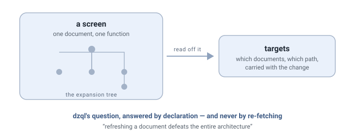
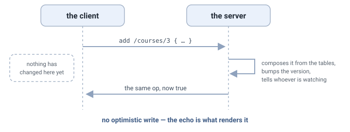
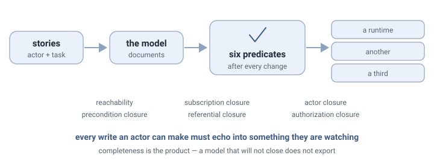
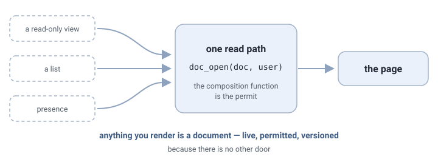
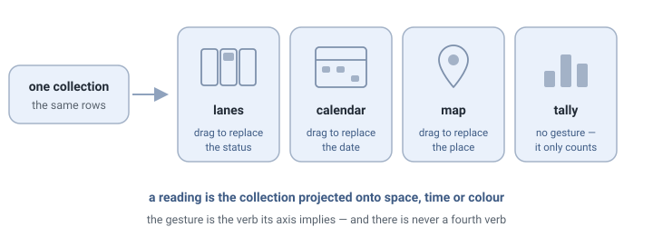
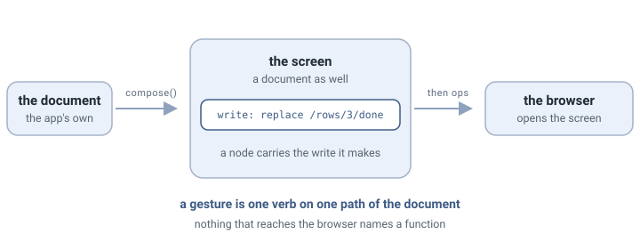
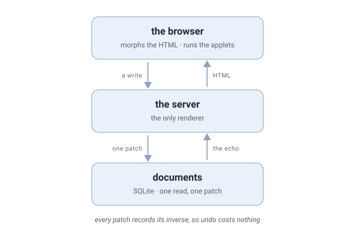
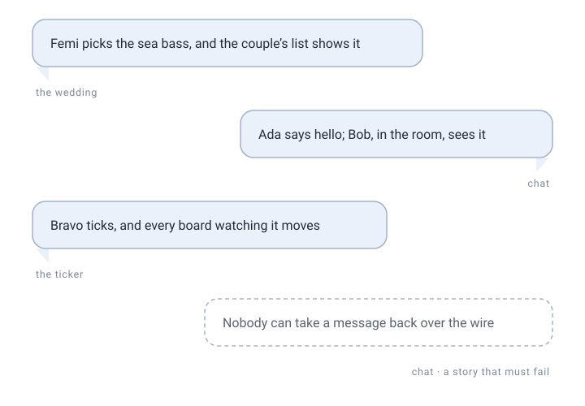

# The Document — a thought history

> **A record.** Kept as it was written, for the history and the citations. How an app is made
> now is the root [README](../../README.md#how-an-app-is-made); where this differs from the code, the code is
> right.

dzql → seiro → simple (+easy) → railroad → delta → hjeli → epsilon →
apples & pears → zeta → eta → eta on delta.
One idea carried from the first to the last, through a year of clean rewrites:
**the thing the user sees is a document — a composed shape — and keeping it
truthful against relational tables is the whole problem.**

## dzql (Sep 2025 – Jan 2026) — the problem is named

A database-first compiler: declare a domain in `domain.ts`, compile to Postgres
stored functions + a typed WS client + Pinia stores. "Document" here means the
denormalized read shape the client holds — `get` returns "a rich document".
`vision.md` names the crux: **the view maintenance problem** — "how do you
update all client documents that have this org expanded, without re-fetching?"
The client patched documents in place via a compiled table→path map
(`PATH_MAPPINGS`), but the server-side "which documents did this write touch?"
resolver (`_affected_documents`) was never finished. That loose end drives
everything after.

## seiro (Jan – Feb 2026) — the thesis is written down

CQRS over one WebSocket (commands = plpgsql functions, events via NOTIFY).
The runtime has no document at all — but the modelling database does, as its
hub: `documents`, `document_entities`, `document_queries`. Its schema header is
the manifesto: *"Documents are central — they're what clients get and update."*
The `cqrs-document` skill adds the method: start from "what does the user
see?", sketch the document, **derive** the entities from it. Seiro's diagrams
show `subscribe("Catalogue")` — a protocol it never implemented.

## simple + easy (Feb – Apr 2026) — documents become screens, Claude becomes the compiler

A pair: **Easy** is the modelling tool, **Simple** the app template — "design
with Easy, build with Simple." Easy holds the domain in SQLite (`model.db`)
behind a small CLI and a browsable model site. Its entry point is the **story**
— a use case, `actor + action`, linked to the entities, documents, and methods
that serve it — so design starts from what people do, and the site draws the
use-case and entity diagrams (PlantUML) to show it. Documents sit in the model
as first-class artifacts with expansion trees; `export` emits the `spec.md`
that Claude's `/implement` builds from.

In Simple, **"documents are screens"** — one per screen, modelled
declaratively as a root entity + an expansion tree, compiled to one Postgres
`*_doc(user_id, id)` JSONB function. dzql's unfinished question gets a
declarative answer: change **targets** (which docs, which collection path) are
derived from the expansion trees, carried in `pg_notify`, merged by the client.
Rule of the house: postgres owns everything; never re-fetch — refreshing a doc
"defeats the entire architecture".

## railroad + delta (Mar – Jun 2026) — the document becomes a runtime object, then a package

Railroad (signals, JSX-to-real-DOM, no build step) grew a delta-doc module:
**a document is a named, patch-synced JSON tree whose client identity is a
signal** — `openDoc(name)` returns `{ data: Signal, send(ops) }`. Three verbs
(add/replace/remove) on JSON-Pointer paths. Then the deliberate split: 0.7.0
removed it — "railroad was the proving ground; delta is the finished product."

Delta made the document the unit of *everything*: subscription channel,
version counter, write path, auth boundary. Its key move is the **doc as
lens**: `defineDoc(prefix, { root, include, scope })` — a document is composed
*in Postgres* from relational tables, and doc names are data (`venue:42`,
`venue-at:42:2026-06-16`). No optimistic writes: the echo renders the write.
Three backends (JSON file → SQLite → Postgres) behind one client API.

## hjeli (May – Jun 2026) — the design method gets a proof engine

The easy/seiro modelling line, rebuilt for delta-doc — and sharpened into a
thesis: **"a document is not a view of an entity; it is what an actor sees in
order to do a job."** Design lives at *document altitude* (actor + task),
resisting the constant pull down to *entity altitude* (tables and CRUD
mirrors — the LLM's comfortable default). Stories still come first, but where
easy drew diagrams to browse, hjeli runs **six predicates** after every change
— reachability, subscription closure, actor closure, precondition closure,
referential closure, authorization closure. Completeness is the product. And
the hard object shifts again: not the document but the **context** — the
closed set of documents an actor watches, proven by subscription closure:
*every write an actor can make echoes back into something they're watching*.

As of 0.6.0 (Aug 2026), a passing model exports to **three substrates**:
delta (`types.ts` + `init_db/`), Supabase (migrations, the same generated
RLS re-keyed on `app_uid()`, actions as transactional RPCs), and **epsilon**
(doc types on the doc kit emitted into a `bun create` app — composition as
the permit, dispatches that record their own inverses, and a `proveLaw`
scaffold per doc type). One proven model, three runtimes — and what a
target can't lower it routes to a named custom stub, never half-lowered.

## epsilon (2026) — the document totalised

"The next letter after delta. One op stream, Postgres to pixel." Not a library
— ~3.8k lines vendored into your app. Merges the two halves: **the delta IS
the signal** — one op-carrying Signal class on both sides, the WebSocket
hidden inside `apply()`. The doc/signal seam that delta and railroad kept is
deleted.

### What epsilon preserved

- **Doc as lens over tables** (delta) — now the *only* tier. A JSONB-blob
  storage tier existed and was retired in 0.10.0: "in six releases no app ever
  hosted a blob." The `docs.data` column survives, frozen.
- **The three verbs + JSON Pointer** (railroad's delta.ts, via delta) —
  `op.ts` is "adapted from @blueshed/delta core.ts".
- **Echo renders the write** — credited in source as "delta's rule".
- **Doc names are data** (`board:42`, `mine:<uid>`) — per-identity docs are
  per-identity *names*, never per-viewer composition.
- **The affected-documents question** (dzql → simple's targets) — dissolved:
  `doc_commit` bumps, logs, and notifies in one place; multi-doc writes use
  transactional mirrors. The question no longer needs a resolver.
- **"Documents are central"** (seiro) — pushed to totality: *"anything you
  render is a doc — live, permitted, versioned, because there is no other
  door."* Even read-only views (`pgView`) and presence are docs.

### What epsilon added

- A **doc registry in the schema**: `docs` table + `doc_ops` as event log,
  audit trail, and undo log — one table, three duties.
- `doc_open(doc, user)` — the ONE read path, and **the composition function is
  the permit**.
- The **doc kit** (`db/003-doc-kit.sql`): a new doc type is ~30 lines of app
  SQL — one composition query, one dispatch function.
- **The law**: `proveLaw()` drives ops over the real wire and proves the client
  copy equals recompute-from-tables after every echo, undo included.

## apples & pears (Sep 2026) — the document drawn and touched, over a listening protocol

Two documents, `Workshop/apples_pears`, three days (5–7 Sep), a hobby
lineage meeting the main line. **Pears** is a protocol for listening,
devised in 1995 at iChat, Austin, and written down here in JSON-RPC form:
seven methods, three notifications, how a node is declared, changed, read
and watched, and how a change reaches what watches it. It says nothing
about how a node computes, where it is stored, or how it is drawn. **Apples**
says how a document is *drawn and touched*, and opens by naming the stack
it means to be the third document of: hjeli says what a document is, pears
how a change travels, apples which readings a collection has and which
gesture each offers. Fifteen editions of one, twelve of the other, each
cut after a build made from the text alone (twenty-four such runs, japan,
roles, calendar, location, projects, a crm, and two wedding models), and
one application, *Can You?*, the ask as a shared task graph, measured
against `concept/constitution.md`.

### What apples & pears preserved

- **Doc as lens over tables** (delta, epsilon). A document is a spanning
  tree of the schema chosen for one actor's attention; the tables are the
  truth; the server composes rows and the client composes structure.
- **The three verbs + JSON Pointer** (railroad, delta). Apples "never adds
  a fourth": a gesture is one verb on one path, and the axis decides which.
- **Echo renders the write** (delta's rule). "There is no optimistic apply
  and there must not be one: the round trip is designed, not hidden."
- **Doc names are data** (delta, epsilon). `/trip/42`, `/party/OKAFOR`: a
  keyed document is a node named by its key.
- **Document altitude and the tree grammar** (hjeli). The sixth edition
  threw away its own words for the tree — root, follow, cut, carry — after
  two wedding builds showed hjeli already had a grammar with proofs behind
  it; the eighth borrowed hjeli's ownership paths, `owner`, `grant`, `gate`,
  rather than inventing a read clause. "Every word it uses for the tree is
  hjeli's."
- **Stories first, utility measured** (easy, concept). `caption` and
  `required` arrived from the constitution; Can You? keeps a verb ledger in
  clicks and keystrokes and a list of refusals.

### What apples & pears added

- **A listening protocol as the transport.** Nodes with kinds (a MIME
  type), a definition, a value and an error; cascades along a DAG in a
  stated order; **owned subtrees**, so a document node answers writes to
  its internal paths without a graph node per row; **`at`**, the deepest
  ancestor containing every change between versions, so a notification is
  framed without a client CRDT; **sources** as counter nodes, `/tables/t`,
  so a document names what it reads and a gesture names what it touched;
  the **namespace** kind, so a path nobody declared is refused and not
  remembered; **per-subject composition** on one node, a value per asking
  connection, notified only when that connection's value differs — the
  opposite choice from epsilon's per-identity *names*.
- **The axis.** A collection projected by one or two named fields onto
  space, time or colour: lanes, list, calendar, timeline, gantt, map,
  chips, tally, grid, feed, tree, branch — one reading each, derived from
  a word beside the schema, never a library. The reading's gesture is the
  verb the axis implies; readings are **armed** before they can change
  anything; a filter dims and counts, never hides.
- **The panel.** Every row has one, derived from the declaration: each
  scalar by its kind under the name it is `called`, refused by permission,
  the same panel from every reading. "No reading has to draw a form."
- **Words on a column, gathered per entity.** `self`, `open`, `nobody`,
  `stamp`, `guards`, `within`, `unique`, `called`, kinds on a cell, and the
  permission table drawn as a table: row kind × verb, "the subject may,
  when" — hjeli's authorization closure read from the other end.
- **The ask.** Pears' August vision — a live shared promise between graph
  owners — given its first application: ask someone to do your work, they
  accept, decline or pass it on, tasks wait on tasks, a plan is the shared
  workspace. `self` narrowing a `grant` so that "an offer is answered by
  the side that did not write it" is the write-partitioned document
  (open question 5) met in practice.
- **The isolation build as the test of a spec.** Build from the text
  alone, list every sentence that was ambiguous, silent or wrong, mark each
  *wire* or *not wire*, cut an edition. It proved the engine half of the
  text sufficient in three runs. It also moved the conversation into the
  spec: every ambiguity became a finding and every finding an edition, and
  the state of the design never entered easy or hjeli.
- **In code:** `lib/pears`, the graph and a SQLite composer driven by the
  declaration (zero permission, gesture or sync code in an app's server);
  `lib/apples`, the readings and the panel, plain DOM and SVG, no
  dependencies; both with tests.

### What apples & pears leave open

- **Pears and epsilon.** Two answers to how a change travels: a listening
  graph with cascades, or an op log with replay. Layers, alternatives, or
  does the ask need something an op log does not give? Neither document
  mentions the other.
- **hjeli → apples.** Apples says its tree is hjeli's, and hjeli has no
  export to it. The declaration was hand-authored and argued instead of
  derived, which is where the cost fell. The axis is the one word hjeli
  would have to hold.
- **The readings over which stream.** `lib/apples` takes rows and three
  callbacks — add, replace, remove on a path — and never talks to a
  server. Untested over epsilon.
- **Turn closure and the panel** (open question 6). "Whose move it is
  stays visible on the thing itself" is Can You?'s whole UX and the seventh
  predicate's subject: one concern, derived twice, `export ux` from the
  turn graph or readings from the axes.
- **Identity and a second actor.** The subject is the transport's and the
  repo has no sign-in; a code-bearer as subject works (`code owner`). There
  is no admin: `for admin` is parsed and never read, a carried table
  beneath an owned root inherits write, and a document written for the
  couple is writable by nobody. hjeli's sixth predicate would have said so
  before code existed.
- **The edges the toy models never touched**, found by the wedding on
  8 Sep: a root addressed by a natural key passes the address as the
  child's join value; a has-one composes but cannot be written through;
  a row with a foreign key and no `id` is read as a join row. Engine and
  example, a day's work, once the joins above are decided.
- **A thirteenth edition** is owed and not cut.

**Added, 10 September 2026:** a third document at the root, `bento.md` — how pages,
drawers and modals are composed over a model: one box per ground with a compartment
per thing on it, a collection as a page organised from where you came from, the
breadcrumb as *where am I*, editing always the drawer, a modal only for a named
thing made or destroyed, a choice the row can carry on the row. Agreed over a
wireframe and then built into the wedding the same day.

### 11 Sep 2026: Can You? from the text alone; the page folded in

A third document, **bento.md** (10 Sep, two editions, agreed over the
wedding's wireframe), said how pages, drawers and modals are composed over
a model: one box per ground, a collection as a page, the breadcrumb as
where am I, edit the drawer, new or delete the modal, a choice the row can
carry on the row. On 11 Sep it was folded into apples.md as *The page*
(fourteenth edition; pears seventeenth), and both documents took Can You?
as their worked example throughout: declared, page by page, on the wire.
The test was an isolation build in `Workshop/can_you`: the two documents,
`lib/`, hjeli in Docker and Bun, nothing else, and the app the README
describes had to come out. It did (`apples_pears/examples/can_you_2`;
fourteen findings in its FINDINGS.md, the page table in PAGES.md), and the
directory was removed the same day.

- **The page table comes first, and its closure must be run, not written.**
  Writing the table before the client made the client a transcription: two
  pages, two modals, no drawer, one control on the row. The one false cell
  ("accepts or declines … the state on the owner's home") was found only by
  running each story's control and echo through the table, and everything
  wrong on screen followed from it.
- **A ground opens a sheet when it fits one, a box only past that**: "more
  than a sheet holds", not "has things of its own".
- **One `Bun.serve`, routes, an HTML import.** Never a fetch that switches
  on the pathname; the page is imported, not assembled. The library's
  carrier could not be mounted that way, a finding against the library:
  `lib/pears` now exports `carrier`, `upgrade` and `PidFile`, and
  `PearsServer` is built from them.
- **Apples' notation lowers to hjeli's JSON** with apples' words as extra
  properties, and hjeli audits it green unchanged. The declaration types
  took hjeli's shape (`kind`, `source`, `node`) across the whole repo.
  hjeli's `export sql` is Postgres for delta; the SQLite schema is a hand
  lowering, the "hjeli → apples" gap above met in practice.
- **The declaration carried the whole permission table.** Every refusal
  the stories need came from the words through `lib/pears` with no code in
  the app, and pears.md's wire example matched message for message.

### 12 Sep 2026: Can You? 3, told story by story; hjeli and apples measured from both sides

The rules for using the two documents were cut from them into `.claude/rules/`
(eight files, six loading as the work reaches them), and a Can You? was modelled
from nothing in hjeli, story by story with Peter, no earlier attempt read:
eleven stories, one actor, five entities, four documents, six predicates green
(`apples_pears/examples/can_you_3`). Then the picture (the plane: waits across,
placed down, composed by *next* and *while* from the wall), the page table,
and the declaration in apples' words, run over a hand schema before it was
kept. Fourteen findings against hjeli and three against apples; five of hjeli's
fixed the same day in `blueshed/hjeli` (unreleased), each with a test.

### What it preserved

- **Stories first, and the model is determined by them** (easy, hjeli). Told
  raw, the model converged on the shape apples already had for Can You?; every
  entity and document was demanded by an audit or implied by a story. The loop
  ran at the speed of conversation.
- **The picture is the brief** (the atlas, the wedding). No derivation
  produced the plane; Peter's memory of the wall's *next* and *while* settled
  it where three sketches only forced the question. Apples carries the rule as
  *A ground drawn as itself*, rule 18.
- **The method's order** (apples, the can_you_2 round): picture, stories,
  declaration run not read, table with its closure run story by story, then a
  build that is transcription. The handoff point is when the two judgement
  artefacts exist.

### What it added

- **Generation is the test, not the audit.** Twice the six predicates were
  green over a policy that refused the story (the creator could ask nobody; a
  date compared with the string NULL). The proof is per actor type, the
  enforcement per row, and only the export shows the difference. hjeli's
  feature request names the check that would close it.
- **Dates as flags met two grammars written for enums.** `completed_at`,
  `accepted_at`, `declined_at`, null meaning undecided, is the better model;
  neither hjeli's path conditions (`IS NOT NULL`, now added) nor apples' gate
  (`gate <field> = <value>`, still open) could say "is set" that morning.
- **Can You?'s two sides are one actor type.** hjeli's separation of duties
  cannot see that the asker and the asked are different people of one kind:
  open question 5, the write-partitioned document, met in practice.
- **Reuse is at the level of grammar and readings**, not app code: five hjeli
  findings fixed in an afternoon under its own tests; the drawer, the modal,
  the crumbs and the wall are the library's; the plane is the one new reading.
- **The hjeli → apples gap measured from both sides.** The model lowered to
  fifty lines of notation and produced three findings against apples: a join
  row keyed by a plain value has no word; a gate cannot say accepted; the
  picture added `y` without a story.
- **The rules as the portable layer.** `apples.md`, `pears.md` and
  `.claude/rules/` name no example, ledger or person and travel together; the
  repo's patterns stay in its CLAUDE.md.

### What it leaves open

- **Whether the files alone carry a builder.** `EXPERIMENT.md` is the brief
  for a fresh session; nothing above is proved until that session builds the
  app right without Peter guessing for it.
- **Deltas, not recomposition.** lib/pears recomposes a per-subject document
  on every source yield; the frame should be the op, with targets derived from
  the declaration (ledger `deltas-not-recomposition`).
- **hjeli's four gaps**: a guard over a collection, separation of duties per
  row, per-verb policies, the lowered-policy check.
- **Apples' two**: `key` on an array node; a gate on a set date.
- **Craft needs a render loop.** Mockups drawn by hand and not looked at were
  wrong in every detail Peter checked; the brief makes rendering and looking a
  step, not a habit.

## zeta (Aug – Sep 2026) — the browser as a terminal

A fork of epsilon at 0.10.4 that adds the one thing epsilon left to the app: the
screen. `zeta/` is the vocabulary, the diff, the executor, the screen host,
derivation and applets; apps live under `examples/`, each with its own server,
client, migrations and tests. The thesis is `plan2.md`, the record `DECISIONS.md`.

**A screen is a doc.** `screen:todos:<uid>` is composed on the server from the
app's document by a pure `compose(doc) → tree`, sent once whole and thereafter
as epsilon's three verbs. The client opens the screen and nothing else; it never
learns the shape of the document behind it.

**A gesture is one verb on one path.** A node that can be touched carries
`write: { op, path }`; the executor sends exactly that; the screen forwards it to
the document's dispatch as the user; the echo recomposes the screen. Nothing that
reaches the browser names a function, so there is no call the declaration did not
already allow.

**The screen is derived, not written** — from a `Table` declared in TypeScript
that a test checks against the live schema, so a column that moved fails the
suite rather than the page. **Applets** are the only client-side behaviour: props
in, one value out through the node's write, lookups through the server method the
tree names. The typeahead is the first.

### What zeta preserved

- **Doc as lens, the three verbs, echo renders the write, doc names as data** —
  epsilon's, unchanged. zeta is the first of this line that did not start again
  from nothing: a fork, kept as a fork.
- **One read path.** A screen is composed through the same door as any other
  document, so a screen nobody may compose is a screen nobody can open.

### What zeta added

- **The screen as a document**, which puts the interface under every rule the
  data already obeyed: versioned, permitted, patched rather than re-sent.
- **The gesture as declaration.** A write is data on a node, not a handler. The
  client is an executor; a new control is a new row in the tree.
- **Derivation checked against the database**, so the model in TypeScript and the
  schema in Postgres cannot drift quietly apart.

### What zeta leaves open

- **Whether the screen should be a document at all.** eta's first commit landed
  on the day of zeta's last. The next attempt kept the screen on the server and
  sent HTML instead of a tree, and neither settles the question — zeta's answer
  keeps one vocabulary everywhere; eta's removes a layer.

## eta (14–17 Sep 2026) — the kernel

Sixty-four releases in four days, for a kernel of about four thousand lines with
one runtime dependency — an icon set that the kernel itself does not import.
Three things that compose:

**Documents.** The whole app is documents in SQLite, each with one `read()` and
one `patch()`. A write is a patch: a document, a JSON Pointer path, a value.
Because every write is a patch, every write has an inverse, and the ledger
records both at the moment of writing — so undo is not a feature added later, it
is what the write already was. A removed course comes back with its dishes.

**Render.** The server is the only renderer. A compartment turns a document into
HTML for one person, and the browser keeps that HTML alive by morphing, so a
re-render never disturbs what someone is in the middle of doing and a render can
be as small as the change. HTML is the only vocabulary on the wire: no node tree,
no JSON. The session sits beside the compartments as the tray — which page, which
drawer — and undo, redo and leaving are tools rather than compartments of their own.

**Applets.** Where a page needs behaviour of its own — a figure being dressed, a
price board moving — an applet takes its data as props and answers with writes.

Three examples ask things of the kernel and are known by it in no way at all:
`chat`, a room with people in it; `wedding`, a site with a Lego minifigure builder
and a live photograph of everyone coming; `ticker`, a price board and a Swiss
railway clock. `src/` never imports one, and `history/` records what each example
asked for, item by item.

**The two canons**, from `stories.md`: everything can be seen by someone — no
write lands nowhere, and the story says whose page shows it — and every change is
complete and consistent. hjeli proved the first on a model, with predicates,
before code existed. epsilon proved the second on the wire, with a law, after.
**eta does both on the running app**, from one file of stories, needing neither a
model beside it nor a copy of the document in the browser to compare against.

### What eta preserved

- **The three verbs on JSON Pointer paths** (railroad's delta.ts → delta →
  epsilon), now as patches whose inverses are written with them.
- **Echo renders the write** (delta's rule), and **stories first** (easy, hjeli):
  a story is a person's intent in a sentence a customer could call true or false,
  and a story describing what the interface does is the sign a feature was
  invented first.
- **Doc names are data**, and the document as the unit of subscription, version
  and permit.

### What eta added

- **The inverse recorded at write time**, which makes undo and redo free and
  auditable rather than a feature with its own state.
- **HTML as the only vocabulary**, deleting the client's model of the document
  altogether: the kernel's client is 2.6 KB, and there is no framework to learn.
- **A wire a person can read.** Only documents, patches and HTML cross it, so an
  app can be watched, inspected and undone from a terminal with no browser open.
- **Zero infrastructure**: one process, one SQLite file, no queue, cache or build
  step — Bun makes that the ordinary option rather than an austere one.
- **A grading, taken.** On 17 September a first-principles review (asked for by
  Peter, written by Claude) put it at DRY code C+, docs F; KISS C−; YAGNI D
  against the project's own rule; Bun B+. The next three releases were almost
  entirely deletions: six write paths became one, four notify paths became one,
  seventeen of the wedding's sixty-three stories and eight of the ticker's went
  because they only described the interface moving and could not fail, and the
  reference went from 4,700 words to 1,700. One deleted story — *Grace claims the
  kettle from its drawer; the couple see it claimed* — was false and passed.

### What eta leaves open

- **The stories checked the tables, not what each person was sent**, which is how
  a false story passed under 100% coverage. Fixed at 0.44.0; the general lesson —
  that coverage measures the wrong thing when the assertion is aimed wrong — is
  not yet anywhere but here.
- **The under-used platform is the browser**, says the same review: the runtime is
  used well and no layer exists because a Bun feature was missed, but the client
  is deliberately thin and it is not obvious where that stops being a virtue.
- **The review's remaining proposals are open**, and some are disputed. The
  argument is where the design happens.

## eta on delta (24–25 Sep 2026) — the documents handed back

eta had grown its own documents, its own ledger and its own way of telling a
change. An experiment ported chat onto delta (eta's `experiment/chat-on-delta`),
and the decision followed ([eta-on-delta.md](eta-on-delta.md)): **three
libraries, three jobs.** delta keeps the documents — where their truth lives,
their ledger, and one stream of changes. railroad draws the applets that need
state of their own, as islands. eta keeps the people and the pages. Every
example was ported and eta's own document path was deleted (eta 0.47.0).

Then the question was what the move had cost. zeta, on epsilon, had things eta
did not ([zeta-lost-out.md](zeta-lost-out.md)). Three came back within the day:

- **Undo that will not clobber.** delta 0.7.0 walks back only what an entry
  changed, and only where nobody has changed it since; otherwise it walks
  nothing and says so. eta now looks at a walk before taking it, so a
  document's own rules hold against Undo too — after the wedding's deadline, an
  answer is locked, to Undo as well.
- **A refusal that says why.** A compartment refuses with a reason; the reason
  is state, in the session's own document, off the ledger, drawn beside the
  control that sent it. The wedding's "That code was not recognised" stopped
  being a write.
- **The origin check.** delta 0.8.0 refuses a socket opened from another site.

The same sitting gathered every completeness check from dzql to eta into one
set of rules ([document-proofs.md](../dzql/modelling/document-proofs.md)), and turned the
harness on eta's own stories. Three findings, each a surprise:

- **Stories that nobody could do.** The harness now looks for the control on
  the author's page before it sends the write. Five of the wedding's stories
  had none — no way to take an answer back, to be "not sure", to take a guest
  off — and passed anyway. They are built now.
- **A page told what it did not show.** Checking everyone in the cast, not
  only those named, found the ticker's board carrying the whole market: every
  page changed on every tick, for symbols nobody on it watched. The board is
  now a row per symbol, each on its own document.
- **A button that always fails** now fails its story.

Two outside eyes in the same days: Genoa and Landfall, from 2013
([genoa-landfall.md](genoa-landfall.md)), already had refusal reasons, audit
per row and paging — the first is back, the other two are open. And a CSS
review ([css-review.md](../dzql/rendering/css-review.md)) found the kernel's stylesheet the
most accessible of the line and still short; its accessibility half is done.

railroad 0.14.0, delta 0.8.0 and eta 0.49.0 shipped the lot, through one
release procedure shared by the three.

### What eta on delta preserved

- **The three verbs, the inverse written with the write, HTML as the only
  vocabulary, the server as the only renderer, stories first.**

### What eta on delta added

- **The document as a package, not a kernel's private affair**: its truth, its
  ledger and its stream are delta's, used the same way by anything else.
- **A story is done from the page.** The check that proves it is the one a
  person would make: is there a control for this, where I stand?
- **Everyone is asked.** A story names everyone whose page changes, so a change
  that reaches someone it should not fails by name.

### What eta on delta leaves open

- **A write the server accepts that no page offers.** Finding it needs a list
  of what is permitted, and stories.md waits for that list to be derived from
  the stories rather than written by hand.
- **The model beside the stories** (rules M1–M10). eta's stories run the code;
  nothing checks the documents are complete before a page exists. The eta
  modeller ([eta-modeller.md](../dzql/modelling/eta-modeller.md)) is the attempt.
- **Postgres.** delta's Postgres backend tells a write only to the document
  written through, where SQLite tells every document that holds the row.
  Before eta runs on Postgres, that difference has to close.
- **Sign-in, a lookup through the server, the law per document** — still zeta's.

## The through-line

dzql asked the question (keep client documents true to normalized tables).
seiro declared documents the design centre. easy+simple designed them from use
cases and made them screens with declared change targets. hjeli made the
design method provable — documents as what an actor watches to do a job,
closed into contexts by predicate — and now compiles that proof onto all
three runtimes, epsilon included: the two threads of this history, method
and mechanism, finally meet in one pipeline. railroad/delta made them live runtime objects — a
signal fed by ops, composed in Postgres. epsilon answered the question in the
schema itself: the document is the only read surface, its log is its audit and
its undo, and there's a harness that proves the stream never lies. apples &
pears wrote down, as documents rather than code, how a change travels and how a
collection is drawn and touched. zeta made the screen a document too, so the
interface obeyed the same rules as the data. eta made the whole thing small: the
app is documents in SQLite, the server is the only renderer, HTML is the only
vocabulary, and because every write is a patch every write knows its own
inverse. eta on delta handed the documents back to the package built for them,
and turned the proofs on its own stories: a story is now done from the page, by
a control a person can reach, and everyone is asked whether they saw it.

*(Repo lineage notes: delta's README records dzql → seiro → paintbrush →
"clean" → delta; epsilon cites only delta + railroad. seiro's stated code
ancestor is wicket; simple names neither — each stage was a clean rewrite.)*

## Where this was going all along: stateful development

Every stage was an attempt at one artifact — a **shared state with two
faithful readers**. For the AI it is a recipe: deterministic enough that
regenerating the app is not a gamble. For the human it is a collection of
decisions: legible enough to scroll with a customer and say "is this true?"
dzql put that state in a compiler's input; easy in a database with a face;
simple made Claude the compiler; hjeli made the state provable; the
exporters made it repeatable across three substrates. None of these is the
product — the state is.

The loop is the delta-doc law applied to development itself: **tell a story
(ops on the model), see the change (the human surface re-renders), make the
code (the recompute that must agree).** Expected — the predicates name
what's missing before it surprises anyone. Intended — every record traces
to a story someone told. Repeatable — same state, same app, any substrate.

## Open questions

1. **Does hjeli join epsilon?** — **Answered yes, 2026-08-07 (hjeli 0.6.0):**
   `export epsilon` emits doc types onto the doc kit, the generated dispatch
   refuses any op path the model didn't declare (completeness at runtime),
   and each doc type ships a `proveLaw` scaffold — subscription closure and
   the law are now the same test, run twice: once on the model, once on the
   wire. The method and mechanism threads have rejoined.

2. **Hosting economics at scale.** Hosted docs cost RAM per *concurrent*
   watcher (eviction bounds it), and `mine:<uid>` earns its keep via
   multi-device sync and the transactional mirror. The line to watch:
   mine docs must stay narrow lists — heavy reads belong in `pgView`s.
   Is there a size guardrail, or is it convention?

3. **Does `dev:memory` stay?** The in-memory *substrate* is structural
   (presence, hosting, tests). The `dev:memory` *script* is a shape
   preview with no auth or permits — one line to delete if it ever
   demos the wrong thing. (0.10.0 already demoted it from default.)

4. **What is epsilon, exactly?** ~1.4k lines are the document thesis;
   ~940 (passkeys, router, ui) are app-template conveniences. Both are
   defensible — but "document runtime" and "app template" have different
   minimality tests. Naming which one epsilon is settles what belongs.

5. **The write-partitioned document** (2026-08-08, from the Allertons
   remodel — see `Workshop/rights-market/allertons-convo.md`). A document's writers
   and readers need not be symmetric: in a two-party agreement each
   party writes *its own fields* and both read all. Candidate rule,
   stack-wide: **every field has exactly one writing actor** — cross-
   party write conflict becomes impossible by construction (LWW only
   bites within one party's edits), and it slots in as a seventh hjeli
   predicate (writer closure). A partitioned doc can equally be two
   single-writer docs behind a composed read — field-permits in one
   dispatch vs. composition over a pair are two implementations of the
   same idea. Future action: try the predicate in hjeli; try the
   pattern on an epsilon doc type. *(Now rule M10 in
   [document-proofs.md](../dzql/modelling/document-proofs.md), not built anywhere.)*

6. **Turn closure — the predicate that proves a model *playable***
   (2026-08-08, same sitting; proven on the rights-market model by
   `Workshop/rights-market/derive-ux.ts`). The six predicates prove a
   model closed; none prove an actor can actually *play* it. The
   states + `byOther` structure already in the grammar define a turn
   graph, and it admits its own closure checks: **blind-turn** (it's
   an actor's move but no doc they watch shows the state — found the
   sponsor couldn't see offered campaigns), **self-scoped-turn** (the
   only watching doc is scoped by a column the move itself sets, so
   the row appears only *after* acting — found suppliers couldn't see
   open lines), **exit completeness** (every consumed `byOther` state
   needs its full move set — found seven missing decline/reject/
   withdraw stories and the absent *purchase* move), **unreachable-
   state** (enum variants no story writes — found built/struck: the
   physical work wasn't a move), and **terminal-state** (info only).
   One refinement matters: **inbox turns vs browse turns** — a turn
   visible only via public paramless docs is a marketplace listing,
   where not acting IS the decline; single exits are correct there.
   First run over a six-predicate-green model: 32 findings, 3
   structural. **Promotion gate passed same day**: run over hjeli's
   own samples, the committed-green `workflow` model has real findings
   (Project accepted/rejected unreachable — an accept/reject flow
   nobody can drive; two cross-actor opens), while wedding-planner and
   playground come back clean — a second model wants it, and the
   checks aren't noisy. Recommended split: blind-turn /
   self-scoped-turn / unreachable-state / cross-actor-open red-gate as
   predicate 7; single-exit (inbox vs browse) + terminal-state stay
   advisory in `dump`. The derivation also yields the UX itself (the move
   queue — home is "whose turn", modals are actions, panels are
   documents). Future action: promote into hjeli as predicate seven
   (or 7+8 with [[writer closure|#5]]), and grow `export ux` from
   derive-ux.ts. *(Now rules M8 and M9 in
   [document-proofs.md](../dzql/modelling/document-proofs.md).)*
