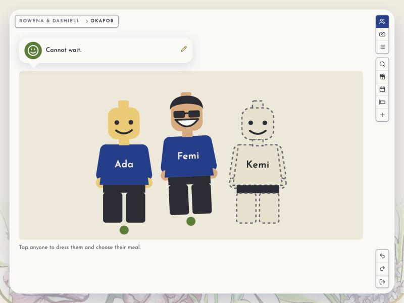

# The thin client: pages drawn on the server

How dzql's rendering (`packages/dzql/src/rendering/`) works, and what a write costs. The manual is
the `dzql-app` skill; a worked app is `packages/dzql/examples/cafe/`. This is the mechanism under
both, for someone deciding whether it suits, or wanting to know why it is built so.

## One renderer, on the server

An app has one `render(sessionId)`: it decides which screen a person is on and draws their whole
page as HTML, reading the documents it shows with `read(name)`
(`packages/dzql/src/rendering/documents.ts`). Reading is how a page subscribes: whatever a page
read, it is told of. `read` is synchronous; a document not yet held throws `Pending`, and the
kernel loads it and draws the page again, so a render never awaits and never half-draws.

There is no state in the browser beyond the page itself. HTML is the only vocabulary on the wire:
no JSON tree of the app's data, no client-side model to keep in step.

## Writes in, parts out

A control sends a write: a document's name and JSON Patch ops on a path (`{ doc, ops }`), never a
verb or a function. On the server it is seen by the document's resource -- `permit` (may this be
sent?), then `shape` (what it becomes) -- then delta applies it, and delta's one stream of changes
says who holds what changed.

Every page that read a changed document is drawn again, and compared with what it was sent last.
A page is cut into **parts** (`part(key, html)`, `packages/dzql/src/rendering/parts.ts`): the
bento's cells, rows with an id, keyed lists, drawers. Only the parts that changed are sent: a part
whose tag changed, its tag; one whose inside changed, whole; a list, the rows put in and taken out.
The page goes whole only when its own outline changed. The client morphs each part into place
(`packages/dzql/src/rendering/client/app.ts`), keeping focus, scroll and whatever a person was
typing; it never replaces `innerHTML`.

So a message said in a room of a hundred goes to each other member as its one `<li>`, not the
conversation again, and nobody whose page did not read the room is sent anything.

## The session, and where a person is

Each visitor has a document of their own, the **session**: who they are and where they are. It is a
resource like any other (`perSession`), found by the cookie, and named on the wire by its type
alone, since its id is a credential. Where a person stands -- the cell they opened, the drawer over
it -- is one **address** in the session, which the URL follows, so a reload, a link or a second tab
opens on the same screen, drawn by the server.

## Undo, refusals and the ledger

Undo is delta's ledger, walked along a cursor that is the person's session: Undo takes back your own
last write while others keep writing, and says so when someone has changed it since. A write
refused (by `permit`, `shape` or the model's guards) is told on the page where it was made, in the
story's words (`toldAt`), and the writer's echo says `refused`.

## Applets and islands

A part of a page whose state a redraw would destroy -- a drag halfway through, a clock, a chart's
history -- is an **applet**: the client never morphs inside it (`[data-applet]`), and it is handed
its document's ops as they come. Written with railroad, it is an **island** (`dzql/rendering/island`),
the one thing that needs the optional `@blueshed/railroad`. Everything else is plain HTML with
`data-write` controls.

## What it is made of

- **[@blueshed/delta](https://www.npmjs.com/package/@blueshed/delta)** keeps the documents, their
  history and their one stream of changes: a JSON file, SQLite, or Postgres compiled by dzql.
- **The client** is the kernel's, <!-- measured:client -->7.4 KB<!-- /measured --> gzipped, with no
  framework to learn.
- **[@blueshed/railroad](https://www.npmjs.com/package/@blueshed/railroad)** draws an island, only
  on a page that has one (<!-- measured:railroad -->2.9 KB
  gzipped for `signal` and `mount`, 3.7 KB with `list`<!-- /measured -->).

It suits small teams where seeing what happened, and being able to undo it, matter more than scale:
a wedding, a booking board, a classroom, an ops console. It is not built for a large consumer
product.

## What a write costs

After a change, each page that shows it gets only the parts that changed, compressed. dzql's `bun
run costs` measures every number on this page from a fresh run of the examples, and its slow tier
(`costs --check`) fails when they drift.

<!-- measured:writes -->
- **Chat**, one message in a room of 100 messages and 5 members: 423 B, compressed from 881 B, to
  each other member (a 182 B patch and 241 B of HTML).
- **The ticker**, one price tick with 5 viewers watching its symbol: 178 B, compressed from 203 B,
  to each other viewer (patches of 90 B and 88 B, and no HTML). The same tick as a bare JSON feed
  would be 41 B.
- **The wedding**, one guest's top changed to green: 823 B, compressed from 2.1 KB, to the same
  household's second tab, on its photo (patches of 147 B and 227 B, and 449 B of HTML); 751 B,
  compressed from 5.3 KB, to the couple, on their photo of families (a 136 B patch and 615 B of
  HTML); 227 B, compressed from 315 B, to another household, on its photo (one patch and no HTML);
  and 227 B, compressed from 315 B, to another household, reading everyone (one patch and no HTML).
<!-- /measured -->

## Further

- [stories.md](stories.md): what the stories are for, and how they drive an app.
- [bento/](bento/README.md): how a page looks and moves.
