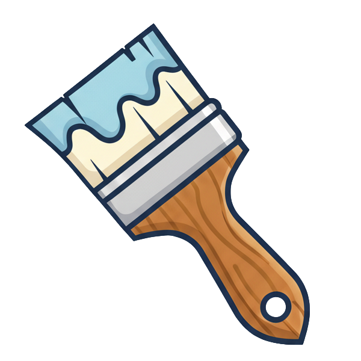

<p align="center"></p>

# Paintbrush

A Bun website where people share documents: open one and you're subscribed, and a change anyone makes reaches everyone holding it at once. Why documents, and how an app is made around them: [bluetools](https://github.com/blueshed/dzql#how-an-app-is-made).

[Bun](https://bun.sh) is the runtime, the bundler, the test runner and the server. [delta](https://github.com/blueshed/dzql/tree/main/packages/delta) keeps the documents, [railroad](https://github.com/blueshed/dzql/tree/main/packages/railroad) draws the page, and [Railway](https://railway.com) deploys it.

It is the light way in, for prototyping. For performance (pages drawn on the server, documents
compiled to Postgres), start with `bun create dzql` instead. Both draw the same page, a bento box
in a plain look, so a prototype keeps its look as it grows.

Requires Bun 1.4.3 or later.

```sh
bun create blueshed myapp
cd myapp
bun dev
```

Open `http://localhost:3000` in two windows. You get a message, a shared document: a save in one window shows in the other. There's a line saying whether your data survives a deploy, and tests for all of it.

## Bun does the work

- **Routes** are `Bun.serve()` routes, all written out in `src/routes.ts` (delta serves them): the page, `GET /api/status`, `/ws` and `/health`.
- **The page** is an imported `index.html`. Bun bundles the TypeScript, JSX and CSS it references, so there is no build step in development.
- **Documents** ride one WebSocket, a route like any other. delta keeps each one (the message's rows are a JSON file in the data folder) and tells every page holding it of every change.
- **Tests** are `bun test`. Routes are tested with `fetch`, a document with a client in the test, and the page in a real browser with `Bun.WebView`. The run fails below 100% coverage.

## Routes, resources and documents

Here is where each part of [the shape](https://github.com/blueshed/dzql#how-an-app-is-made) lives in paintbrush (CLAUDE.md has it as a table):

- **Server routes** are in `src/routes.ts`. HTTP routes serve what isn't communication: the health check, files, the server's status. Everything people share is a document on `/ws`.
- **Client routes** are the address, in `src/app.tsx`: the bento's `here` says the page and what is open over it (a drawer, a modal), `go` moves there, and Back closes what is open.
- **A resource** is a folder, `src/resources/<name>/`, with three files:

| File | Role |
|------|------|
| `<name>-api.ts` | The server side: the document it registers, or the handlers that return a `Response`; and the type both sides share |
| `<name>.ts` | The client: the document it opens, or what it fetches |
| `<name>-view.tsx` | The view: a function component, reactive through signals |

Every route and document is visible in the code. An AI, or a person, can read `routes.ts` and `app.tsx` and know exactly what the app does.

## How it grows

The `evolve` skill grows the app from its stories: another document, two on one page, keeping them in SQLite or Postgres as the documents need, migrations, sign-in by link, routes and a build, each with code and tests.

## What's in the box

```
stories.ts           what the app was asked to make true, a sentence each, each told by a test
src/routes.ts        the routes, and the documents on one WebSocket; served by delta's one server
src/app.tsx          the socket every document rides, and the page: a box of cells, drawers over it
src/index.html       the page; Bun bundles the TypeScript and CSS it references
src/styles.css       the design: dzql's plain look for the bento, then the page
src/resources/       message/ and status/, three files each, the bento (and its lucide marks), a toast
tests/               routes with fetch, documents with a client, the page in a real browser (Bun.WebView), the entry point
.railway/            the deploy, as code, with a volume for the data
```

`bun dev` serves with hot reload, and `bun run start` serves the same source in production, with nothing to build. `bun test` runs everything. `.railway/railway.ts` deploys it: `railway config plan` shows what would change, and nothing is applied until you say so.

## Made to be worked on with Claude

Ask for something, and Claude writes it into `stories.ts` as `story(...)`, then a test named from it makes it true. `CLAUDE.md` says what is here and the rules; the `evolve` skill is how the app grows; `CHANGELOG.md` and `todo.jsonl` are the project's memory between sessions, and `/release` turns one into a version. On GitHub, CI runs the tests in the runner's Chrome on every push.

## Starting from it

`bun create` runs `create/setup.ts` after installing. Your app gets its own name, a fresh ledger and changelog, the skills (its own `evolve`, and those its packages ship: [CLAUDE.md](CLAUDE.md) says which), and a first commit. What is about the template stays behind: its logo and ledger, the setup script, its own tests and the skill's evaluations. The app's changelog starts by naming the create-blueshed version it came from: to bring an app up to date, read [create-blueshed's changelog](../CHANGELOG.md) from that version on, and carry across what applies.

MIT
